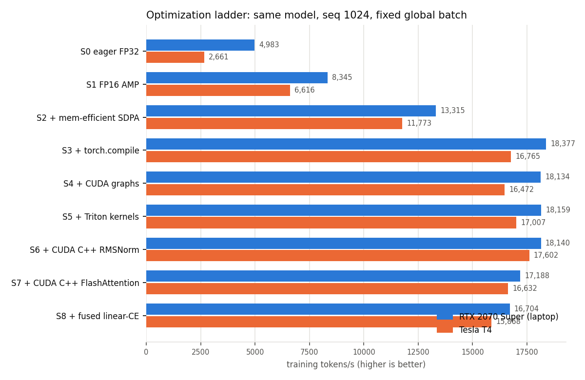
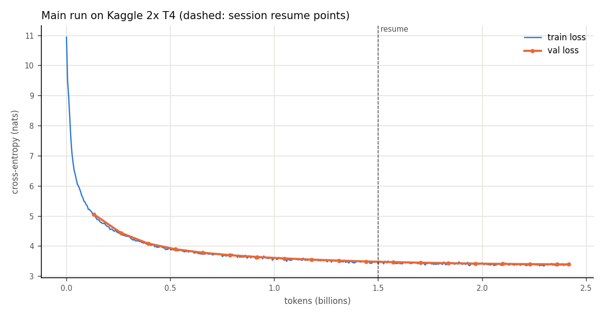

# NanoNemo

A 114M-parameter Llama-style language model pretrained from scratch on ~2.4B tokens of NVIDIA Nemotron-CC, and the training made progressively faster on Turing GPUs (an RTX 2070 Super laptop, Tesla T4s) — every step measured, and every custom kernel checked against a plain-PyTorch reference.

## What's here

- **Model** (`nanonemo/model/`): decoder-only, pre-norm RMSNorm, RoPE, SwiGLU, grouped-query attention (12 query / 4 KV heads), tied embeddings. 12 layers, d_model 768, seq 1024, GPT-2 tokenizer (vocab padded to 50,304). The PyTorch reference path is kept and every optimized path is tested against it.
- **Optimization ladder** (`configs/stages/`): S0 eager FP32 → S1 FP16 AMP → S2 memory-efficient SDPA → S3 `torch.compile` → S4 CUDA graphs → S5 Triton kernels → S6 CUDA C++ RMSNorm → S7 CUDA C++ FlashAttention → S8 fused linear + cross-entropy. One change per stage; each stage is a YAML file differing from the previous one in one marked line.
- **Custom kernels** (`nanonemo/kernels/`), all `torch.library` custom ops (they compile with `fullgraph=True` and run under CUDA graphs):
  - Triton: fused residual-add + RMSNorm, SwiGLU, RoPE on Q and K in one launch, and the cross-entropy half of the fused LM-head loss.
  - CUDA C++: fused residual-add + RMSNorm (warp per row, 16-byte loads, shuffle reduction), and a FlashAttention-2 forward + backward for sm_75 on tensor cores (WMMA), causal, reading GQA's KV heads directly.
- **Multi-GPU** (`nanonemo/distributed/`): DDP with bucket tuning, FSDP2 (`fully_shard` per block, explicit prefetch, per-block compile), tensor parallel + sequence parallel with DTensor. DCP checkpoints (async, resumable on a different layout), a wall-clock session limit for Kaggle's 12-hour sessions.
- **What trained the released model**: the S3 stack (FP16 AMP, PyTorch's memory-efficient SDPA, `torch.compile`) with DDP on 2× T4, 3.7× the FP32 eager baseline on the laptop at a fixed clock (6.3× on a T4). The custom kernels (S5–S8) were not used for it: they measured 0.99–1.05× over `torch.compile` (S5/S6) or slower (S7 0.94–0.95×, S8 0.95–0.97×), and the multi-GPU tests and LR sweep were validated on S3. Afterwards the S6 kernel stack was validated in DDP training (`configs/main_kernels.yaml`: a 100M-token run matches the plain run's loss within 0.03). The ladder is the result for the kernels: where hand-written kernels beat `torch.compile` on Turing at this model size, and where they don't.
- **Measurement**: CUDA-event step timing with GPU clock monitoring that flags throttled runs (`nanonemo/train/bench.py`), kernel microbenchmarks with CUDA-graph replay and L2 flushes (`benchmarks/kernels/`), Nsight Compute and Nsight Systems scripts, MFU that counts the tied LM head.
- **Evaluation**: checkpoints export to Hugging Face Llama format (logits verified identical) and run through lm-evaluation-harness with exactly the same settings as GPT-2 124M.

## Results

All tables below are generated from `results/` by `scripts/make_figures.py`; the full set (including every kernel row) is in [docs/results.md](docs/results.md).

<!-- results:start -->
### Optimization ladder: RTX 2070 Super (laptop)

| Stage | Tokens/s | MFU | Peak mem alloc / reserved | Loss (last step) | SM clock | Δ vs previous |
|---|---|---|---|---|---|---|
| S0 eager FP32 | 4,983 | 14.1% | 5.86 / 6.28 GB | 6.772 | 1140 MHz | — |
| S1 FP16 AMP | 8,345 | 23.5% | 5.55 / 5.94 GB | 6.775 | 1140 MHz | 1.67× |
| S2 + mem-efficient SDPA | 13,315 | 37.5% | 4.31 / 4.69 GB | 6.770 | 1140 MHz | 1.60× |
| S3 + torch.compile | 18,377 | 51.8% | 3.25 / 3.67 GB | 6.769 | 1140 MHz | 1.38× |
| S4 + CUDA graphs | 18,134 | 51.1% | 1.99 / 4.05 GB | 6.777 | 1140 MHz | 0.99× |
| S5 + Triton kernels | 18,159 | 51.2% | 1.99 / 4.05 GB | 6.774 | 1140 MHz | 1.00× |
| S6 + CUDA C++ RMSNorm | 18,140 | 51.2% | 1.99 / 4.05 GB | 6.772 | 1140 MHz | 1.00× |
| S7 + CUDA C++ FlashAttention | 17,188 | 48.5% | 1.99 / 4.02 GB | 6.773 | 1140 MHz | 0.95× |
| S8 + fused linear-CE | 16,704 | 47.1% | 1.99 / 3.68 GB | 6.773 | 1140 MHz | 0.97× |

All stages measured in one session with the SM clock locked at 1140 MHz (`nvidia-smi -lgc`), so rows are directly comparable; MFU is against the peak at the rated boost clock, so it reads low.

### Optimization ladder: Tesla T4

| Stage | Tokens/s | MFU | Peak mem alloc / reserved | Loss (last step) | SM clock | Δ vs previous |
|---|---|---|---|---|---|---|
| S0 eager FP32 | 2,661 | 3.3% | 5.86 / 6.28 GB | 6.767 | 885 MHz | — |
| S1 FP16 AMP | 6,616 | 8.1% | 5.55 / 5.94 GB | 6.775 | 930 MHz | 2.49× |
| S2 + mem-efficient SDPA | 11,773 | 14.5% | 4.31 / 4.69 GB | 6.775 | 930 MHz | 1.78× |
| S3 + torch.compile | 16,765 | 20.6% | 3.25 / 3.67 GB | 6.765 | 795 MHz | 1.42× |
| S4 + CUDA graphs | 16,472 | 20.2% | 1.99 / 4.05 GB | 6.764 | 810 MHz | 0.98× |
| S5 + Triton kernels | 17,007 | 20.9% | 1.99 / 4.05 GB | 6.772 | 840 MHz | 1.03× |
| S6 + CUDA C++ RMSNorm | 17,602 | 21.6% | 1.99 / 4.05 GB | 6.762 | 900 MHz | 1.03× |
| S7 + CUDA C++ FlashAttention | 16,632 | 20.4% | 1.99 / 4.02 GB | 6.767 | 915 MHz | 0.94× |
| S8 + fused linear-CE | 15,868 | 19.5% | 1.99 / 3.68 GB | 6.759 | 900 MHz | 0.95× |

All stages measured in one session; the GPU's clock is not lockable here, so the median SM clock is shown per stage.



### Multi-GPU (Kaggle 2x T4)

| GPU | Strategy | GPUs | Tokens/s | Scaling eff. vs 1 GPU | Peak mem/GPU | SM clock (median) |
|---|---|---|---|---|---|---|
| t4 | 1 GPU | 1 | 16,326 | 100% | 4.46 GB | 825 MHz |
| t4 | DDP (default buckets) | 2 | 33,838 | 104% | 4.85 GB | 690 MHz |
| t4 | DDP (100 MB buckets, grad views) | 2 | 33,129 | 101% | 4.88 GB | 675 MHz |
| t4 | FSDP2 | 2 | 26,065 | 80% | 5.42 GB | 900 MHz |
| t4 | FSDP2 + prefetch | 2 | 26,032 | 80% | 5.42 GB | 900 MHz |
| t4 | FSDP2 + prefetch + per-block compile | 2 | 26,132 | 80% | 5.45 GB | 915 MHz |
| t4 | TP=2 + SP | 2 | 16,005 | 49% | 3.44 GB | 1305 MHz |

All rows from one Kaggle session. T4 clocks are not lockable and drift with temperature (see the SM clock column), so scaling efficiencies within a few percent of 100% are not distinguishable from it.

### Our kernels in DDP training (Kaggle 2x T4)

| Config | Tokens/s | Speed vs plain DDP | Val loss after 100M tokens (LR 3e-4) |
|---|---|---|---|
| Plain DDP (S3 stack), run first / last | 35,518 / 30,233 | 1.00× | 5.781 |
| DDP + our kernels, S6 stack (norm, SwiGLU, RoPE) | 32,310 | 0.91–1.07× | 5.800 |
| DDP + our kernels, S7 stack (+ our FlashAttention) | 30,297 | 0.85–1.00× | — (speed only) |

### Model quality (zero-shot, lm-evaluation-harness 0.4.9, identical settings)

| Model | Tokens trained | HellaSwag (acc_norm) | ARC-Easy (acc_norm) | PIQA (acc_norm) | LAMBADA (acc) | Val loss |
|---|---|---|---|---|---|---|
| GPT-2 124M (HF `gpt2`, evaluated by us) | ~10B+ (published) | 31.1% ± 0.5% | 39.5% ± 1.0% | 62.5% ± 1.1% | 32.6% ± 0.7% | n/a |
| NanoNemo-114M (ours) | 2,414,870,528 | 28.9% ± 0.5% | 42.4% ± 1.0% | 60.7% ± 1.1% | 17.1% ± 0.5% | 3.397 |

### Main run


<!-- results:end -->

Design decisions, with the measurements behind them, are in [docs/decisions.md](docs/decisions.md); the chronological record, including what didn't help, is in [docs/devlog.md](docs/devlog.md).

## Reproduce

Everything runs in an NGC PyTorch container (`docker/Dockerfile`, pinned to `25.11-py3`, PyTorch 2.10 / CUDA 13.0 / Triton 3.5).

```bash
scripts/run_container.sh python -m pytest -q                  # unit, kernel, parity, distributed (CPU gloo) tests
scripts/run_container.sh python -m nanonemo.data.prepare --source nemotron_cc --cc-files 12 \
    --out data/nemotron_cc --max-train-tokens 2500000000 --val-frac 0.004 --shard-tokens 100000000
scripts/run_ladder.sh                                         # every ladder stage, re-running throttled ones
scripts/run_container.sh python benchmarks/kernels/rmsnorm.py # kernel microbenchmarks (also swiglu, rope, flash_attn)
scripts/run_container.sh benchmarks/kernels/ncu.sh            # Nsight Compute reports for our kernels
scripts/run_container.sh python scripts/eval.py --model gpt2 --name gpt2-124m
scripts/run_container.sh python scripts/export_hf.py --ckpt runs/main/ckpt --out exports/nanonemo
scripts/run_container.sh python scripts/eval.py --model exports/nanonemo --name nanonemo
scripts/run_container.sh python scripts/make_figures.py       # tables + figures from results/
```

Multi-GPU runs and the main run are on Kaggle 2× T4 with `notebooks/kaggle_train.ipynb`; the session-to-session checkpoint hand-off is in [docs/kaggle_workflow.md](docs/kaggle_workflow.md).

## Limitations

- Turing has no BF16 or FP8 tensor cores, so all training here is FP16 with loss scaling.
- The laptop GPU's clocks depend on the platform's thermal and power management, so the laptop ladder is measured in one session with the SM clock locked at 1,140 MHz (its base clock). Kaggle doesn't allow locking clocks; each T4 table comes from a single session and shows the measured clock.
- The CUDA FlashAttention uses the WMMA API rather than hand-written `mma.sync` PTX. After the backward rewrite (1.84× faster) it is within 9–22% of PyTorch's CUTLASS memory-efficient kernel, but not ahead of it (see the devlog).
- One data epoch of ~2.4B tokens is far less than GPT-2's training budget, so the quality comparison is about what that budget buys, not a claim of parity.
