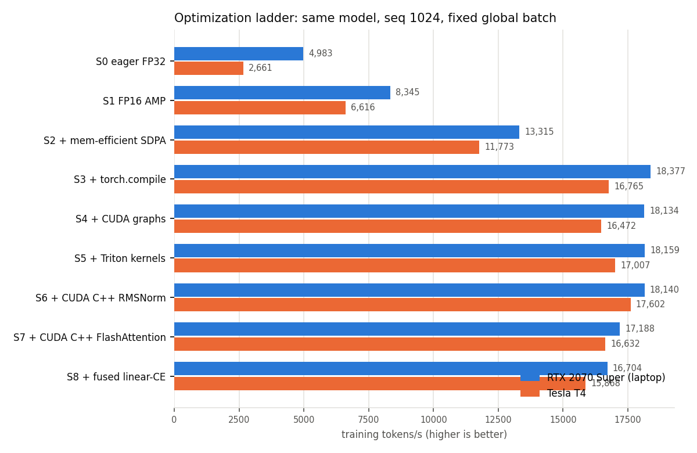
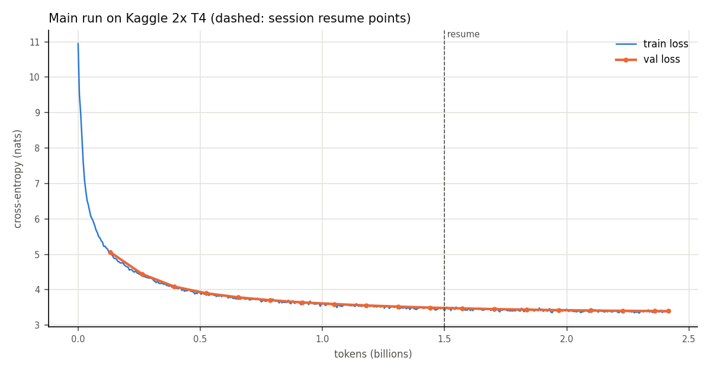

# NanoNemo: report

A 114M-parameter Llama-style language model, pretrained from scratch on 2.4B tokens of Nemotron-CC, with its training made progressively faster on NVIDIA Turing GPUs and every speedup measured. This report covers what was built, what each optimization bought, what didn't pay off and why, and how the final model compares with GPT-2 124M.

All numbers here come from files in `results/`; the tables are regenerated by `scripts/make_figures.py`. Every benchmark table was measured in a single session per GPU, with the current code; the laptop's GPU clock was locked for it. The chronological record (including dead ends) is [devlog.md](devlog.md), and the reasoning behind each design choice is [decisions.md](decisions.md).

## 1. Summary

| | |
|---|---|
| Model | 114,150,144 parameters, 12 layers, d_model 768, GQA (12 query / 4 KV heads), RoPE, SwiGLU, RMSNorm, tied embeddings |
| Data | Nemotron-CC v1 `quality=high`, real web text: 2.416B train tokens, 9.5M val tokens |
| Main run | 2,414,870,528 tokens (one epoch), Kaggle 2× T4, DDP, two 12-hour sessions with checkpoint hand-off |
| Final val loss | **3.397** (train 3.38) |
| Main-run throughput | 36.2k tokens/s median on 2× T4, 22% MFU, 4.9 GB per GPU |
| Speedup of the training stack (S0 → S3) | **3.7×** on the RTX 2070 Super at a fixed clock, **6.3×** on a T4 |
| Multi-GPU (one session) | DDP 33.8k tok/s on 2× T4 (≈100% scaling), FSDP2 26.1k (80%), TP=2 + SP 16.0k (49%) |
| Custom kernels | Triton and CUDA C++ RMSNorm, SwiGLU, RoPE: 0.99–1.05× over `torch.compile`; CUDA FlashAttention: backward made 1.84× faster, now 0.94–0.95× of CUTLASS end to end; fused linear + CE: 0.95–0.97× |
| Quality | HellaSwag 28.9%, ARC-Easy **42.4%**, PIQA 60.7%, LAMBADA 17.1%, against GPT-2 124M's 31.1 / 39.5 / 62.5 / 32.6, with roughly a quarter of its training tokens |

The main findings:

1. **Most of the speedup comes from using the hardware's existing paths well.** FP16 tensor cores (1.67× laptop, 2.49× T4), a memory-efficient attention kernel (1.60×, 1.78×) and `torch.compile` (1.38×, 1.42×).
2. **Hand-written kernels mostly don't beat `torch.compile` at this model size on Turing.** The fused RMSNorm moves 83% of peak DRAM bandwidth against Inductor's 49% in isolation, yet end to end the S5/S6 kernels measure 1.00× on the laptop and 1.03–1.05× on a T4, because the compiler had already fused the same ops and the step is dominated by matmuls and attention.
3. **FlashAttention on Turing is the hard case.** Profiling showed the backward kernel running one block per SM; restructuring it to work from registers and prefetch its inputs made it 1.84× faster, but PyTorch's CUTLASS kernel is still 9–22% faster, so the stage with our attention is 0.94–0.95×.
4. **DDP is the right layout for a model this small.** FSDP's per-layer parameter traffic and TP's per-layer collectives cost more than they save when the model fits easily on one GPU.
5. **A 114M model trained on 2.4B tokens of curated web text comes close to GPT-2 124M** on most benchmarks and beats it on ARC-Easy. LAMBADA, which rewards long-range narrative modelling, is the exception.

## 2. Hardware and environment

| GPU | Where | Notes |
|---|---|---|
| RTX 2070 Super (laptop, sm_75, 8 GB, 115 W) | development, ladder, kernels, eval | FP16 tensor cores with FP32 accumulate run at half rate on GeForce Turing: 28.3 TFLOP/s peak at the rated 1,380 MHz boost |
| Tesla T4 (sm_75, 16 GB, 70 W) | Kaggle 2× T4 notebooks: ladder, multi-GPU, main run | 65 TFLOP/s datasheet peak, but power- and temperature-limited to ~650–950 MHz in practice |

Everything local runs in the NGC PyTorch container `25.11-py3` (PyTorch 2.10, CUDA 13.0, Triton 3.5). Kaggle uses its own image (PyTorch 2.11, Python 3.13) plus `requirements-kaggle.txt`.

Two environment facts shaped the project early:

- **Triton 3.4+ has no tensor-core `tl.dot` on Turing.** A 20-line Triton matmul ran at 1.8 TFLOP/s against cuBLAS's 20.9; ncu showed zero tensor-pipe instructions and the PTX had `fma.rn` instead of `mma.sync`. Bisecting found that Triton 3.0 and 3.2 emit `mma.sync`, while later versions fall back to FMA on sm_75. So Triton is used only for memory-bound kernels, and FlashAttention is written in CUDA C++.
- **Turing has no BF16 or FP8 tensor cores,** so all training is FP16 with dynamic loss scaling.

## 3. Data

- **Source:** Nemotron-CC v1, `quality=high`, `kind=actual` (no synthetic text), downloaded as JSONL over HTTPS. Twelve files, one from each of twelve crawl eras between 2013 and 2024, 4.1 GB compressed.
- **Cleaning:** 3,306,160 documents → 134,077 dropped as too short (< 200 characters) → 3,263 exact duplicates removed → 3,168,820 kept. Nemotron-CC is already deduplicated and quality-filtered upstream, so heavier curation was skipped.
- **Split:** decided per document by a hash of its ID, before tokenizing, so no document straddles train and val.
- **Format:** GPT-2 BPE tokens as `uint16` shards with a 256-byte header (magic, version, token count, tokenizer). Writes are atomic (temp file, `fsync`, rename); reads are `np.memmap`, so the 4.6 GB set is never loaded into RAM. A manifest records each shard's checksum, and the loader checks headers and exact file sizes at startup.
- **Result:** 2,415,765,275 train tokens (25 shards) and 9,481,778 val tokens (1 shard), tokenized in 7m52s on 16 cores with under 1 GB of RAM. Uploaded as a private Kaggle dataset.

The loader serves 1,025-token windows at stride 1,024 in a per-epoch permutation. Its whole state is one integer (the micro-step), the sample index formula gives each data-parallel rank disjoint samples, and the state is converted through the global sample count when the number of ranks changes. It feeds about 81M tokens/s including the pinned-memory host-to-GPU copy, so no worker processes are needed.

## 4. Model and trainer

Decoder-only, pre-norm: RMSNorm (FP32 reduction) → GQA attention with rotate-half RoPE → residual → RMSNorm → SwiGLU MLP → residual. 12 layers, d_model 768, 12 query heads sharing 4 KV heads, head dimension 64, sequence length 1,024, vocabulary 50,304 (GPT-2's padded to a multiple of 64), input and output embeddings tied. 114.15M parameters, 75.5M of them outside the embedding.

Each block was built against an independently written reference (a by-hand formula, `F.rms_norm`, a complex-number RoPE, a per-head attention loop) and tested before the next was added. The PyTorch reference path is kept, and every optimized path is tested against it.

The trainer uses AdamW (β 0.9/0.95, weight decay 0.1 on matmul weights only, fused implementation), linear warmup then cosine decay to 10% of peak, gradient clipping at 1.0 and exact gradient accumulation. The learning rate is a pure function of the step, so resuming needs no scheduler state. It logs to `metrics.jsonl` and optionally Weights & Biases.

## 5. Measurement methodology

- `scripts/bench_train.py` times the trainer's own `train_step` on real data: 5 untimed warmup steps (compile and graph capture), then 3 trials of 50 optimizer steps, each step bracketed by CUDA events. It reports median and min/max tokens/s, MFU, peak memory, and the GPU's clock, temperature and power during each trial.
- **MFU** counts the tied LM-head matmul (798 MFLOP per token at seq 1,024). Peaks use the FP32-accumulate tensor-core rate at the rated boost clock.
- **One session per table.** Comparisons are only made between numbers measured back to back, with the same code.
- **The laptop's clock is locked.** The laptop drops to its 1,140 MHz base clock once it heats up, and its boost behaviour changed with an OS update during the project. All laptop benchmarks were therefore run with the SM clock locked at 1,140 MHz (`sudo nvidia-smi -lgc 1140,1140`). The harness reads the lock from `NANONEMO_LOCKED_SM_MHZ`, records it in every result, and flags any trial below 98% of it or with a thermal or hardware slowdown reason. At the lock the GPU draws 77 W and stays under 60 °C, and every stage was clean on its first attempt. Absolute numbers are about 20% below boost-clock numbers; the ratios between stages are what the tables are for.
- **Kaggle doesn't allow locking clocks.** T4 tables come from one session each and show each row's median SM clock.
- **Kernel microbenchmarks** capture each call in a CUDA graph and replay it with L2 flushed before each replay, so they measure GPU time only. Achieved bandwidth is reported against the minimum bytes the kernel must move, and Nsight Compute reports are in `results/ncu/`.
- Ladder stages differ by exactly one setting (a test enforces this), and each stage was parity-tested against the previous one. Every stage, on both GPUs, reaches the same loss at step 155 (6.759–6.777) from the same initialization and data.

## 6. The optimization ladder

Single GPU, sequence length 1,024, micro-batch 2, 16,384-token steps.

| Stage | RTX 2070 Super tok/s (1,140 MHz locked) | Δ | T4 tok/s | Δ |
|---|---|---|---|---|
| S0 eager FP32, math attention | 4,983 | — | 2,661 | — |
| S1 FP16 AMP + GradScaler | 8,345 | 1.67× | 6,616 | 2.49× |
| S2 + memory-efficient SDPA (CUTLASS) | 13,315 | 1.60× | 11,773 | 1.78× |
| S3 + `torch.compile` | 18,377 | 1.38× | 16,765 | 1.42× |
| S4 + CUDA graphs | 18,134 | 0.99× | 16,472 | 0.98× |
| S5 + Triton RMSNorm/residual, SwiGLU, RoPE | 18,159 | 1.00× | 17,007 | 1.03× |
| S6 + CUDA C++ RMSNorm/residual | 18,140 | 1.00× | 17,602 | 1.03× |
| S7 + CUDA C++ FlashAttention | 17,188 | 0.95× | 16,632 | 0.94× |
| S8 + fused linear + cross-entropy | 16,704 | 0.97× | 15,868 | 0.95× |

What each stage did:

- **S1 FP16 (1.67× laptop, 2.49× T4).** Matmuls move to tensor cores. The T4 gains more because its FP16 tensor-core peak is 8× its FP32 peak, against 4× on GeForce Turing. Memory barely drops, because math attention still writes the full 1,024 × 1,024 score matrix per head.
- **S2 memory-efficient attention (1.60×, −1.25 GB).** The fused CUTLASS kernel never materializes the scores. Pinning the backend mattered: left to choose, PyTorch already picked this kernel even in FP32, which would have made the "eager FP32" baseline faster than a true reference.
- **S3 `torch.compile` (1.38×, −1.05 GB).** Inductor fuses RMSNorm, RoPE, SwiGLU and the residual adds into Triton kernels. Those ops are memory-bound, so fusing them saves both time and saved-activation memory. This is the stack that trained the released model.
- **S4 CUDA graphs (no gain).** At 2,048 tokens per micro-batch the GPU is fully busy and the CPU launches kernels faster than the GPU runs them, so there is no launch overhead to remove. Building it surfaced a real bug: under gradient accumulation, autograd adopted the first micro-batch's gradient from the graph's memory pool, and the next replay overwrote it. Gradients are now allocated once outside the pool.
- **S5–S8** are the custom kernels, covered in the next section.

At S3 the laptop reaches 51.8% MFU against the rated-boost peak, which is about 63% of the peak at the 1,140 MHz it was locked to. The T4 reads 20.6% against its datasheet peak, but it ran at ~800 MHz; against the peak at that clock it reaches about 41%.

## 7. Custom kernels

All custom kernels are `torch.library` custom ops with registered fake implementations and autograd formulas. They compile with `fullgraph=True` and run under CUDA graphs, and each is switched on per kernel in `ModelConfig`. Each has forward/backward tests over a grid of shapes (odd sizes, strided inputs) in FP32 and FP16, FP64 `gradcheck`, `opcheck`, and whole-model parity tests.

### 7.1 Triton: fused residual + RMSNorm, SwiGLU, RoPE (S5)

To fuse the residual add into the norm, blocks pass `(x, delta)`: `delta` is the previous sublayer's output, not yet added. Each norm computes `h = x + delta` and returns `(rmsnorm(h), h)`, writing the normalized output directly in FP16 under autocast. SwiGLU's backward recomputes the sigmoid instead of saving it. RoPE rotates all Q and K heads of a token in one launch, and its backward is the same kernel with `sin` negated.

Microbenchmarks on the laptop (locked clock), forward + backward as a percentage of the 448 GB/s DRAM peak:

| Kernel | Eager | `torch.compile` | Ours (Triton) | Ours (CUDA) | Liger 0.8.5 |
|---|---|---|---|---|---|
| Add + RMSNorm (AMP, 8,192 rows) | 15% | 49% | **83%** | **83%** | 42% |
| Add + RMSNorm (FP16, 8,192 rows) | 9% | 59% | 74% | **79%** | 56% |
| SwiGLU (FP16, 8,192 × 2,048) | 51% | 90% | 89% | — | 89% |
| RoPE (FP16, B=8, T=1,024) | 5% | 82% | 82% | — | 87% |

The fused norm wins clearly over both Inductor and Liger. SwiGLU and RoPE are elementwise, and Inductor already generates kernels at the same bandwidth. End to end, S5 is 1.00× on the laptop and 1.03× on the T4: the norm's advantage is a fraction of ~50 µs per call in a step dominated by matmuls and attention, and Inductor had already fused these ops in S3.

### 7.2 CUDA C++ RMSNorm (S6)

The same op as the Triton norm: one warp per row, 16-byte vector loads, the row held in registers, shuffle-only reductions. It ties the Triton kernel on the AMP case and is 5 points ahead on the all-FP16 backward. The backward first trailed by 20% at 2,048 rows, because 4 blocks per SM meant 640 per-warp weight-gradient partial rows to write and sum; 2 blocks per SM brought it level. End to end S6 is 1.00× over S5 on the laptop and 1.03× on the T4 (1.05× over `torch.compile`).

### 7.3 CUDA C++ FlashAttention-2 for sm_75 (S7)

Causal, native GQA (each query head reads its KV head directly, no repeat), head dimension 64, FP16 inputs with FP32 accumulation, forward and backward, on tensor cores through the WMMA API.

**Getting it working.** The first three versions, measured at the model's shape (B=2, T=1,024) on boost clocks against CUTLASS's 266 µs forward and 1,095 µs forward+backward:

| Version | Forward | Fwd + bwd | What changed |
|---|---|---|---|
| 1. One query row per block, scalar FMA | 33,569 µs | 94,939 µs | Correct, but a block-wide reduction per score |
| 2. 64 × 32 tiles on tensor cores (WMMA 16×16×16) | 1,514 µs | 3,969 µs | dK/dV accumulated in registers per key block |
| 2b. Output kept in registers, cheaper softmax | 643 µs | 3,064 µs | O fragments rescaled in registers; half a row per lane |
| 3. Shared-memory rows padded by 16 bytes | 293 µs | 1,825 µs | ncu showed 81–86% L1/shared throughput at 12% SM: bank conflicts |

**Making the backward fast.** Version 3's forward was within 10% of CUTLASS, but its backward was 1.85× slower. ncu showed why: the backward block used 33,024 bytes of shared memory, so only one 4-warp block fit per SM. That gave 12.5% occupancy (one warp per scheduler, nothing to hide latency) and 8.9% tensor-pipe activity. Most of that memory was FP32 staging: S and dP were written out only to be read back for the elementwise step, and dQ and dK/dV went through it again on the way out. Two changes:

- **Work from the accumulator fragments.** Each element's (row, column) in a WMMA accumulator is read from two index fragments built once per warp. P and dS are computed in registers and written as FP16, dQ is added into global memory straight from its fragment, and dK/dV are stored straight from theirs. The block drops to 23,808 bytes, so two blocks fit per SM, with one fewer block-wide barrier per tile.
- **Prefetch the next tile.** The top stall was then waiting on global loads: every (query head, query tile) step loaded Q, dO, L and D synchronously. Turing has no `cp.async`, so the next step's tiles are loaded into registers while the current one computes.

At the profiler's base clock and the model's shape, the **backward went from 2.16 to 1.17 ms (1.84× faster)**, with warps active 12.5% → 24% and tensor-pipe activity 8.9% → 18.3%. The forward is unchanged (0.45 ms). All tests pass unchanged.

Against CUTLASS at the locked clock, ours takes:

| Shape | Forward | Forward + backward |
|---|---|---|
| B=32, T=256 | **0.90×** (ours faster) | 1.27× |
| B=8, T=1,024 | 1.15× | 1.20× |
| B=2, T=4,096 | 1.29× | 1.14× |

End to end S7 is 0.95× of S6 on the laptop and 0.94× on the T4 (it was 0.88× with the old backward). What remains is mostly the dQ atomics (issued in fragment order, so each warp request spans 8 memory sectors) and register pressure (172 per thread, which caps occupancy at two blocks per SM). Hand-written `mma.sync`/`ldmatrix` code would give control over both.

Correctness: it matches SDPA's outputs and gradients within FP16 tolerance for MHA and GQA, odd sequence lengths and head dimensions 32/64, and a test confirms that future keys provably don't leak. A compile-only bug was caught on the way: the fake implementation copied the query's strides with `empty_like`, but the kernel returns contiguous tensors, so the compiled model failed at the first transposed input.

### 7.4 Fused linear + cross-entropy (S8)

The LM head and the loss are computed in 512-row chunks: cuBLAS computes a chunk of logits, a Triton kernel writes each row's loss and overwrites the chunk in place with `softmax − onehot`, and cuBLAS computes that chunk's dx and dW. The full (tokens × 50,304) logits never exist, and the backward is done during the forward. Loss and gradients match `F.cross_entropy`.

At micro-batch 2 the logits are only about 200 MB, so the saving is small (peak reserved 3.68 vs 4.02 GB) and the extra chunked matmuls cost 3–5%. It would matter at larger micro-batches or vocabularies.

S8 also exposed a `torch.compile` problem: compilation never finished, and once grew to 30 GB of host RAM and was killed by the OOM killer. A stack dump showed Inductor inside `OperatorIssue.operator_str`, recursively printing IR nodes. For a custom op with no lowering, Inductor takes an implicit-fallback path that formats every argument's IR into a log message, even with logging off. The input to this op is the IR of the whole network, and printing it effectively never ends. Registering the op as an explicit fallback (`make_fallback`) skips that path, and compilation now takes 13 s.

## 8. Multi-GPU (Kaggle 2× T4)

Implemented in `nanonemo/distributed/`:

- **DDP**, with tunable bucket size, gradient-as-bucket-view, and `no_sync` on all but the last micro-batch.
- **FSDP2:** `fully_shard` per block, FP32 gradient reduction, optional FP16 parameter gathers, explicit prefetch, optional per-block compile.
- **Tensor parallel + sequence parallel:** column/row-parallel attention and MLP, norms on sequence shards, a vocabulary-sharded tied embedding and LM head with `loss_parallel`.
- **DCP checkpoints:** each rank writes its own shard in a background thread, and a `latest` pointer is written only after a save completes. Checkpoints reshard on load, so one written by 2 GPUs loads on 1.
- **A wall-clock limit:** all ranks agree on the step to stop at, write a checkpoint and exit cleanly.

Correctness was established first with 2 CPU ranks (gloo), then on the T4s with NCCL (12/12 tests): every layout matches single-process training to 1e-4 on the same global batch, and a run stopped and resumed reproduces the uninterrupted one. That resume test caught a real bug: the loader position is per rank, so it is now converted through the global sample count when the world size changes. TP with whole-model `torch.compile` failed in backward, so under TP the blocks are compiled individually.

Throughput, S3 stack, 64k-token steps, all rows from one session:

| Layout | GPUs | Tokens/s | Scaling efficiency | Peak mem/GPU | SM clock |
|---|---|---|---|---|---|
| 1 GPU | 1 | 16,326 | — | 4.46 GB | 825 MHz |
| DDP (default buckets) | 2 | **33,838** | ≈100% | 4.85 GB | 690 MHz |
| DDP (100 MB buckets, gradient views) | 2 | 33,129 | ≈100% | 4.88 GB | 675 MHz |
| FSDP2 | 2 | 26,065 | 80% | 5.42 GB | 900 MHz |
| FSDP2 + prefetch | 2 | 26,032 | 80% | 5.42 GB | 900 MHz |
| FSDP2 + prefetch + per-block compile | 2 | 26,132 | 80% | 5.45 GB | 915 MHz |
| TP=2 + SP | 2 | 16,005 | 49% | 3.44 GB | 1,305 MHz |

DDP's computed efficiency is 104%: the 1-GPU row's clock fell from 945 to 690 MHz across its trials, so anything near 100% is within the T4s' thermal drift. The ranking doesn't depend on it, though: DDP ran at the lowest clocks and was still fastest. DDP sends one gradient all-reduce per optimizer step. FSDP2 adds parameter all-gathers and gradient reduce-scatters around every block on every micro-batch, and TP adds collectives inside every layer. Those pay off when a model doesn't fit on one GPU; this one uses under 5 GB of a T4's 15. Bucket tuning made no measurable difference.

## 9. Our kernels in DDP training

The main run used the S3 stack (section 13). Afterwards the custom kernels were checked in real 2-GPU training:

| Config (2× T4, DDP) | Tokens/s | vs plain DDP | Val loss after 100M tokens (LR 3e-4) |
|---|---|---|---|
| Plain DDP (S3), first / last run of the session | 35,518 / 30,233 | — | 5.781 |
| + our S6 kernels (norm, SwiGLU, RoPE) | 32,310 | 0.91–1.07× | 5.800 |
| + our S7 kernels (adds our FlashAttention) | 30,297 | 0.85–1.00× | not trained |

- **Correctness.** A 100M-token DDP run with the S6 kernel stack starts from the identical loss (10.9457) and tracks the plain run's validation loss within 0.013–0.030 nats at every evaluation (5.800 vs 5.781 at the end). The gap appears early and doesn't grow.
- **Speed.** Plain DDP itself drifted from 35.5k to 30.2k tokens/s within the session as the T4s heated up, and the kernel configs fall inside that range. In DDP on Kaggle, any kernel effect is smaller than the thermal drift. On a single T4, S6 measured 1.05× over S3.

`configs/main_kernels.yaml` is the main-run config with the validated S6 kernel stack; `configs/main.yaml` stays as the record of what trained the released model.

## 10. Learning-rate sweep

Three 100M-token runs on 2× T4 with DDP, identical except for the peak learning rate:

| Peak LR | Val loss at 100M tokens |
|---|---|
| **3e-4** | **5.78** |
| 6e-4 | 5.94 |
| 1.2e-3 | 6.17 |

The main run uses 3e-4.

## 11. Main run

| Setting | Value |
|---|---|
| Tokens | 2,414,870,528 (one epoch of the train split) |
| Steps | 4,606 × 524,288 tokens (2 GPUs × micro-batch 4 × 64 accumulation steps × 1,024) |
| Schedule | peak LR 3e-4, 92 warmup steps (2%), cosine decay to 3e-5 |
| Stack | FP16 AMP + GradScaler, memory-efficient SDPA, `torch.compile`, DDP |
| Checkpoints | every 250 steps, asynchronous DCP |

Kaggle sessions end after 12 hours, so the run was split. Session 1 stopped itself on its 11.5-hour limit at step 2,860 (1.5B tokens, val loss 3.50) and wrote a checkpoint. The checkpoint was uploaded as a private dataset, and session 2 resumed from it at step 2,861 and finished. Both sessions were launched from the command line (`kaggle kernels push`) and monitored remotely. The curve shows no step at the resume point: weights, AdamW moments, schedule position, loader position and loss scale all came back exactly.

**Final validation loss 3.397** (perplexity about 29.9), final train loss 3.38. Median throughput 36.2k tokens/s, 22% MFU against the T4's datasheet peak, 4.9 GB per GPU. FP16 never diverged; the loss scale ended at 262,144.

Problems hit and fixed during the run:

- Kaggle unpacked the uploaded checkpoint flat, with `latest` at the dataset root rather than under `ckpt/`, so the notebook's search found nothing. The notebook now also looks for a `latest` next to a `step_*/.metadata`, and refuses to start rather than silently restarting from scratch.
- DCP pickles a path object into `.metadata`. Written under Python 3.13 on Kaggle, it names `pathlib._local`, which Python 3.12 (the local container) lacks. The export aliases the module.
- One downloaded file, the 11-byte `latest` pointer, came back as a Kaggle "502 Server Error" page. The shard files had their exact sizes.
- Logging to W&B through a Kaggle secret doesn't work for notebooks pushed from the command line, because Kaggle doesn't serve secrets to them. Both sessions' `metrics.jsonl` were logged to the W&B run afterwards.

## 12. Evaluation

The final checkpoint was exported to Hugging Face Llama format (weights renamed, not changed; a test checks the logits agree) and evaluated with lm-evaluation-harness 0.4.9, zero-shot, FP32, with the same settings as GPT-2 124M:

| Model | Tokens trained | HellaSwag | ARC-Easy | PIQA | LAMBADA |
|---|---|---|---|---|---|
| GPT-2 124M | ~10B+ (published) | 31.1% ± 0.5 | 39.5% ± 1.0 | 62.5% ± 1.1 | 32.6% ± 0.7 |
| **NanoNemo-114M** | 2.4B | 28.9% ± 0.5 | **42.4% ± 1.0** | 60.7% ± 1.1 | 17.1% ± 0.5 |

With roughly a quarter of GPT-2's training tokens, NanoNemo is within about 2 points on HellaSwag and PIQA and ahead on ARC-Easy (grade-school science), which fits Nemotron-CC's high-quality split being educational, knowledge-dense web text. LAMBADA is the outlier: it asks for the last word of a passage from a novel, which needs long-range narrative tracking. The training data contains little fiction, while GPT-2's WebText has much more.

## 13. What trained the model, and why not the custom kernels

The released model was trained with the S3 stack plus DDP. At the time it was launched, S5 and S6 measured at most 1.06× over S4 and S7/S8 were slower, and the multi-GPU tests and the learning-rate sweep had been done on S3. Switching a 20-hour run to a stack that was slower or within noise, and untested across two GPUs, would have added risk for no gain. The later measurements in sections 6 and 9 confirm the call: no custom-kernel stack is clearly faster than S3 in DDP on the T4s, and the best single-GPU gain is 5%.

The kernels are still the main engineering result of the project. They show where hand-written kernels beat `torch.compile` on Turing (an isolated memory-bound op like the fused norm: 83% of DRAM bandwidth against 49%) and where they don't (end to end, once the compiler has fused the same ops; and attention, where CUTLASS's backward is hard to match). The S6 stack is validated for DDP training (section 9) and ready to use.

## 14. Not done, and limitations

Compared with the original plan:

- **FP8 precision study on an AWS L4:** the code (Transformer Engine linears, FP8 with delayed or current scaling), configs and runbook are in the repo, but it was never run.
- **Nsight Systems traces of the multi-GPU rows,** for the NCCL share of GPU time: Kaggle's image has no Nsight Systems.
- **FlashAttention with hand-written `mma.sync`/`ldmatrix`:** the kernel uses the WMMA API; the remaining gap to CUTLASS is described in section 7.3.
- **A full-length training run with the custom kernels:** the S6 stack was validated over 100M tokens, not a full epoch, and the S7 stack was benchmarked in DDP but not trained.
- **Selective activation checkpointing,** and the stretch items (a Megatron-Core baseline, torchao float8, a Muon optimizer ablation): not built.

Limitations:

- One epoch of 2.4B tokens is far less than GPT-2's budget, so the quality comparison shows what that budget buys, not parity.
- Laptop numbers are at a locked 1,140 MHz, about 20% below what the GPU does at boost when cool; ratios between stages are the comparable quantity.
- Kaggle's T4s run far below their boost clock and drift with temperature within a session, so T4 absolute numbers understate the chip, and differences of a few percent between T4 rows are within noise.

## 15. Reproducing

The README's Reproduce section has the commands: the test suite, data preparation, the ladder and kernel benchmarks, the export and evaluation, and `scripts/make_figures.py`. For laptop benchmarks, lock the clock first (`sudo nvidia-smi -lgc 1140,1140`, and `export NANONEMO_LOCKED_SM_MHZ=1140`). Multi-GPU runs and the main run use `notebooks/kaggle_train.ipynb`, and the session-to-session checkpoint hand-off is described in [kaggle_workflow.md](kaggle_workflow.md).

Checked from a clean clone of the repository at the final results commit: the full test suite passes (275 passed, 2 skipped), and `scripts/make_figures.py` regenerates every committed table and figure with no differences.
