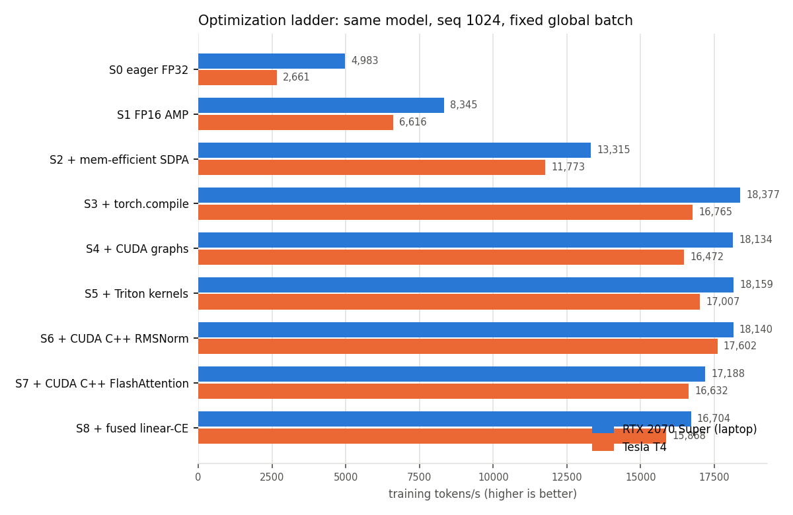
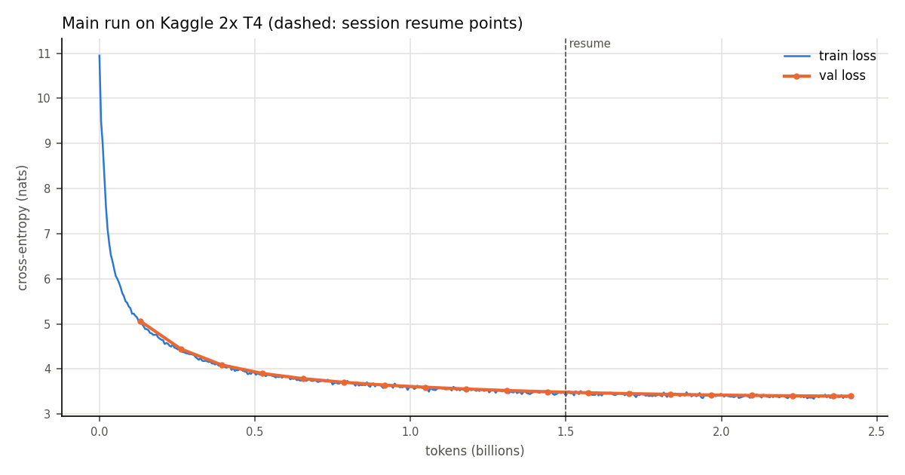

# Results

Generated by `scripts/make_figures.py` from `results/`.

### Optimization ladder: RTX 2070 Super (laptop)

| Stage | Tokens/s | MFU | Peak mem alloc / reserved | Loss (last step) | SM clock | Δ vs previous |
|---|---|---|---|---|---|---|
| S0 eager FP32 | 4,983 | 14.1% | 5.86 / 6.28 GB | 6.772 | 1140 MHz | — |
| S1 FP16 AMP | 8,345 | 23.5% | 5.55 / 5.94 GB | 6.775 | 1140 MHz | 1.67× |
| S2 + mem-efficient SDPA | 13,315 | 37.5% | 4.31 / 4.69 GB | 6.770 | 1140 MHz | 1.60× |
| S3 + torch.compile | 18,377 | 51.8% | 3.25 / 3.67 GB | 6.769 | 1140 MHz | 1.38× |
| S4 + CUDA graphs | 18,134 | 51.1% | 1.99 / 4.05 GB | 6.777 | 1140 MHz | 0.99× |
| S5 + Triton kernels | 18,159 | 51.2% | 1.99 / 4.05 GB | 6.774 | 1140 MHz | 1.00× |
| S6 + CUDA C++ RMSNorm | 18,140 | 51.2% | 1.99 / 4.05 GB | 6.772 | 1140 MHz | 1.00× |
| S7 + CUDA C++ FlashAttention | 17,188 | 48.5% | 1.99 / 4.02 GB | 6.773 | 1140 MHz | 0.95× |
| S8 + fused linear-CE | 16,704 | 47.1% | 1.99 / 3.68 GB | 6.773 | 1140 MHz | 0.97× |

All stages measured in one session with the SM clock locked at 1140 MHz (`nvidia-smi -lgc`), so rows are directly comparable; MFU is against the peak at the rated boost clock, so it reads low.

### Optimization ladder: Tesla T4

| Stage | Tokens/s | MFU | Peak mem alloc / reserved | Loss (last step) | SM clock | Δ vs previous |
|---|---|---|---|---|---|---|
| S0 eager FP32 | 2,661 | 3.3% | 5.86 / 6.28 GB | 6.767 | 885 MHz | — |
| S1 FP16 AMP | 6,616 | 8.1% | 5.55 / 5.94 GB | 6.775 | 930 MHz | 2.49× |
| S2 + mem-efficient SDPA | 11,773 | 14.5% | 4.31 / 4.69 GB | 6.775 | 930 MHz | 1.78× |
| S3 + torch.compile | 16,765 | 20.6% | 3.25 / 3.67 GB | 6.765 | 795 MHz | 1.42× |
| S4 + CUDA graphs | 16,472 | 20.2% | 1.99 / 4.05 GB | 6.764 | 810 MHz | 0.98× |
| S5 + Triton kernels | 17,007 | 20.9% | 1.99 / 4.05 GB | 6.772 | 840 MHz | 1.03× |
| S6 + CUDA C++ RMSNorm | 17,602 | 21.6% | 1.99 / 4.05 GB | 6.762 | 900 MHz | 1.03× |
| S7 + CUDA C++ FlashAttention | 16,632 | 20.4% | 1.99 / 4.02 GB | 6.767 | 915 MHz | 0.94× |
| S8 + fused linear-CE | 15,868 | 19.5% | 1.99 / 3.68 GB | 6.759 | 900 MHz | 0.95× |

All stages measured in one session; the GPU's clock is not lockable here, so the median SM clock is shown per stage.

### Multi-GPU (Kaggle 2x T4)

| GPU | Strategy | GPUs | Tokens/s | Scaling eff. vs 1 GPU | Peak mem/GPU | SM clock (median) |
|---|---|---|---|---|---|---|
| t4 | 1 GPU | 1 | 16,326 | 100% | 4.46 GB | 825 MHz |
| t4 | DDP (default buckets) | 2 | 33,838 | 104% | 4.85 GB | 690 MHz |
| t4 | DDP (100 MB buckets, grad views) | 2 | 33,129 | 101% | 4.88 GB | 675 MHz |
| t4 | FSDP2 | 2 | 26,065 | 80% | 5.42 GB | 900 MHz |
| t4 | FSDP2 + prefetch | 2 | 26,032 | 80% | 5.42 GB | 900 MHz |
| t4 | FSDP2 + prefetch + per-block compile | 2 | 26,132 | 80% | 5.45 GB | 915 MHz |
| t4 | TP=2 + SP | 2 | 16,005 | 49% | 3.44 GB | 1305 MHz |

All rows from one Kaggle session. T4 clocks are not lockable and drift with temperature (see the SM clock column), so scaling efficiencies within a few percent of 100% are not distinguishable from it.

### Our kernels in DDP training (Kaggle 2x T4)

| Config | Tokens/s | Speed vs plain DDP | Val loss after 100M tokens (LR 3e-4) |
|---|---|---|---|
| Plain DDP (S3 stack), run first / last | 35,518 / 30,233 | 1.00× | 5.781 |
| DDP + our kernels, S6 stack (norm, SwiGLU, RoPE) | 32,310 | 0.91–1.07× | 5.800 |
| DDP + our kernels, S7 stack (+ our FlashAttention) | 30,297 | 0.85–1.00× | — (speed only) |

### Model quality (zero-shot, lm-evaluation-harness 0.4.9, identical settings)

| Model | Tokens trained | HellaSwag (acc_norm) | ARC-Easy (acc_norm) | PIQA (acc_norm) | LAMBADA (acc) | Val loss |
|---|---|---|---|---|---|---|
| GPT-2 124M (HF `gpt2`, evaluated by us) | ~10B+ (published) | 31.1% ± 0.5% | 39.5% ± 1.0% | 62.5% ± 1.1% | 32.6% ± 0.7% | n/a |
| NanoNemo-114M (ours) | 2,414,870,528 | 28.9% ± 0.5% | 42.4% ± 1.0% | 60.7% ± 1.1% | 17.1% ± 0.5% | 3.397 |

### Main run

### Kernel microbenchmarks: RTX 2070 Super (laptop)

| Kernel | Case | Provider | fwd µs | fwd+bwd µs | fwd % of DRAM peak | fwd+bwd % of peak |
|---|---|---|---|---|---|---|
| flash_attn | fp16 B32 T256 | sdpa_mem_efficient | 598.0 | 2,044.0 | 13% | 10% |
| flash_attn | fp16 B32 T256 | cuda | 537.5 | 2,588.5 | 14% | 8% |
| flash_attn | fp16 B32 T256 | sdpa_math | 4,964.8 | 10,199.4 | 2% | 2% |
| flash_attn | fp16 B16 T512 | sdpa_mem_efficient | 823.3 | 3,149.8 | 9% | 6% |
| flash_attn | fp16 B16 T512 | cuda | 862.3 | 3,868.9 | 9% | 5% |
| flash_attn | fp16 B16 T512 | sdpa_math | 8,658.7 | 17,907.7 | 1% | 1% |
| flash_attn | fp16 B8 T1024 | sdpa_mem_efficient | 1,312.1 | 5,354.1 | 6% | 4% |
| flash_attn | fp16 B8 T1024 | cuda | 1,514.1 | 6,428.8 | 5% | 3% |
| flash_attn | fp16 B8 T1024 | sdpa_math | 17,251.9 | 34,598.9 | 0% | 1% |
| flash_attn | fp16 B4 T2048 | sdpa_mem_efficient | 2,264.4 | 9,727.9 | 3% | 2% |
| flash_attn | fp16 B4 T2048 | cuda | 2,823.3 | 11,491.4 | 3% | 2% |
| flash_attn | fp16 B4 T2048 | sdpa_math | 32,806.5 | 66,142.4 | 0% | 0% |
| flash_attn | fp16 B2 T4096 | sdpa_mem_efficient | 4,214.4 | 18,782.6 | 2% | 1% |
| flash_attn | fp16 B2 T4096 | cuda | 5,441.5 | 21,354.5 | 1% | 1% |
| rmsnorm | amp 2048x768 | eager | 211.3 | 737.2 | 20% | 13% |
| rmsnorm | amp 2048x768 | compile | 69.3 | 215.0 | 61% | 46% |
| rmsnorm | amp 2048x768 | triton | 51.8 | 133.3 | 81% | 74% |
| rmsnorm | amp 2048x768 | cuda | 53.7 | 141.4 | 78% | 70% |
| rmsnorm | amp 2048x768 | liger | 85.9 | 249.9 | 49% | 39% |
| rmsnorm | amp 8192x768 | eager | 753.4 | 2,709.5 | 22% | 15% |
| rmsnorm | amp 8192x768 | compile | 256.2 | 802.8 | 66% | 49% |
| rmsnorm | amp 8192x768 | triton | 194.6 | 472.5 | 87% | 83% |
| rmsnorm | amp 8192x768 | cuda | 196.5 | 475.1 | 86% | 83% |
| rmsnorm | amp 8192x768 | liger | 327.5 | 925.6 | 51% | 42% |
| rmsnorm | fp16 2048x768 | eager | 224.6 | 731.1 | 13% | 9% |
| rmsnorm | fp16 2048x768 | compile | 40.5 | 120.8 | 69% | 52% |
| rmsnorm | fp16 2048x768 | triton | 36.3 | 100.7 | 77% | 63% |
| rmsnorm | fp16 2048x768 | cuda | 35.8 | 102.1 | 78% | 62% |
| rmsnorm | fp16 2048x768 | liger | 36.9 | 130.0 | 76% | 49% |
| rmsnorm | fp16 8192x768 | eager | 814.0 | 2,681.0 | 14% | 9% |
| rmsnorm | fp16 8192x768 | compile | 163.7 | 430.1 | 69% | 59% |
| rmsnorm | fp16 8192x768 | triton | 131.3 | 339.9 | 86% | 74% |
| rmsnorm | fp16 8192x768 | cuda | 133.8 | 321.3 | 84% | 79% |
| rmsnorm | fp16 8192x768 | liger | 131.6 | 454.3 | 85% | 56% |
| rope | fp16 B=2 T=1024 | eager | 332.2 | 773.1 | 6% | 5% |
| rope | fp16 B=2 T=1024 | compile | 28.4 | 54.5 | 66% | 69% |
| rope | fp16 B=2 T=1024 | triton | 27.3 | 51.4 | 69% | 73% |
| rope | fp16 B=2 T=1024 | liger | 26.0 | 47.8 | 72% | 78% |
| rope | fp16 B=8 T=1024 | eager | 1,219.5 | 2,893.8 | 6% | 5% |
| rope | fp16 B=8 T=1024 | compile | 92.5 | 183.7 | 81% | 82% |
| rope | fp16 B=8 T=1024 | triton | 93.2 | 183.2 | 80% | 82% |
| rope | fp16 B=8 T=1024 | liger | 88.2 | 173.0 | 85% | 87% |
| swiglu | fp16 2048x2048 | eager | 109.7 | 302.9 | 51% | 49% |
| swiglu | fp16 2048x2048 | compile | 67.6 | 173.1 | 83% | 87% |
| swiglu | fp16 2048x2048 | triton | 67.6 | 173.0 | 83% | 87% |
| swiglu | fp16 2048x2048 | liger | 67.6 | 173.9 | 83% | 86% |
| swiglu | fp16 8192x2048 | eager | 423.3 | 1,178.1 | 53% | 51% |
| swiglu | fp16 8192x2048 | compile | 254.0 | 668.3 | 88% | 90% |
| swiglu | fp16 8192x2048 | triton | 254.3 | 673.8 | 88% | 89% |
| swiglu | fp16 8192x2048 | liger | 254.0 | 673.7 | 88% | 89% |
