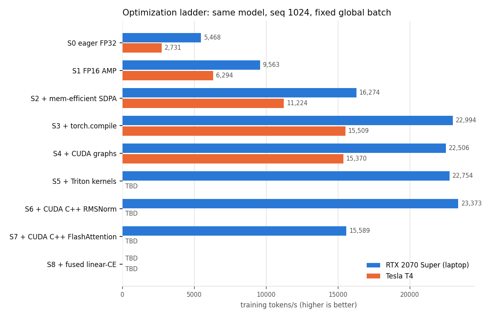
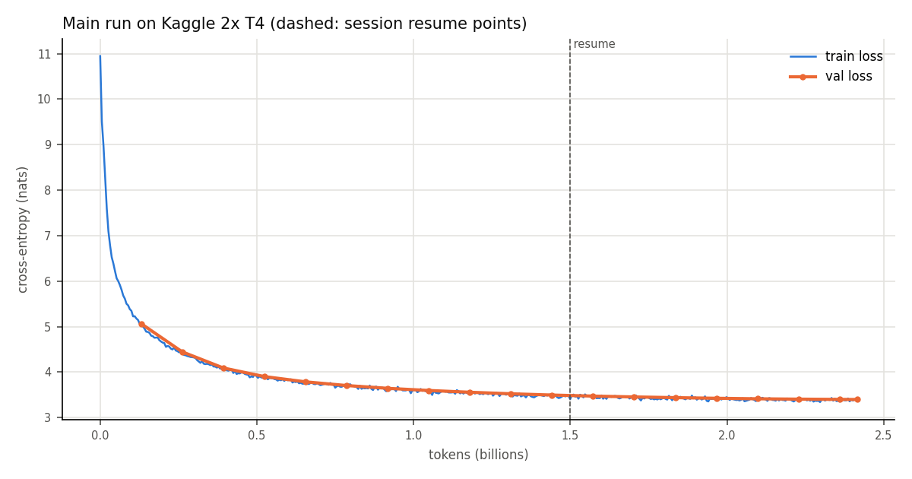

# Results

Generated by `scripts/make_figures.py` from `results/`.

### Optimization ladder: RTX 2070 Super (laptop)

| Stage | Tokens/s | MFU | Peak mem alloc / reserved | Loss (last step) | Δ vs previous |
|---|---|---|---|---|---|
| S0 eager FP32 | 5,468 | 15.4% | 5.86 / 6.30 GB | 6.772 | — |
| S1 FP16 AMP | 9,563 | 27.0% | 5.55 / 5.89 GB | 6.775 | 1.75× |
| S2 + mem-efficient SDPA | 16,274 | 45.9% | 4.30 / 4.69 GB | 6.774 | 1.70× |
| S3 + torch.compile | 22,994 | 64.8% | 3.25 / 3.67 GB | 6.767 | 1.41× |
| S4 + CUDA graphs | 22,506 | 63.5% | 1.99 / 4.05 GB | 6.771 | 0.98× |
| S5 + Triton kernels | 23,754 | 67.0% | 1.99 / 4.05 GB | 6.763 | 1.06× |
| S6 + CUDA C++ RMSNorm | 23,986 | 67.6% | 1.99 / 4.05 GB | 6.780 | 1.01× |
| S7 + CUDA C++ FlashAttention | 21,011 | 59.2% | 1.99 / 4.02 GB | 6.772 | 0.88× |
| S8 + fused linear-CE | 20,443 | 57.6% | 1.99 / 3.68 GB | 6.770 | 0.97× |

### Optimization ladder: Tesla T4

| Stage | Tokens/s | MFU | Peak mem alloc / reserved | Loss (last step) | Δ vs previous |
|---|---|---|---|---|---|
| S0 eager FP32 | 2,731 | 3.4% | 5.86 / 6.30 GB | 6.767 | — |
| S1 FP16 AMP | 6,294 | 7.7% | 5.55 / 5.89 GB | 6.775 | 2.30× |
| S2 + mem-efficient SDPA | 11,224 | 13.8% | 4.30 / 4.69 GB | 6.772 | 1.78× |
| S3 + torch.compile | 15,509 | 19.0% | 3.25 / 3.67 GB | 6.772 | 1.38× |
| S4 + CUDA graphs | 15,370 | 18.9% | 1.99 / 4.05 GB | 6.769 | 0.99× |
| S5 + Triton kernels | 15,334 | 18.8% | 1.99 / 4.05 GB | 6.776 | 1.00× |
| S6 + CUDA C++ RMSNorm | 15,253 | 18.7% | 1.99 / 4.05 GB | 6.775 | 0.99× |
| S7 + CUDA C++ FlashAttention | 14,191 | 17.4% | 1.99 / 4.02 GB | 6.769 | 0.93× |
| S8 + fused linear-CE | 13,771 | 16.9% | 1.99 / 3.68 GB | 6.772 | 0.97× |

### Multi-GPU (Kaggle 2x T4)

| GPU | Strategy | GPUs | Tokens/s | Scaling eff. vs 1 GPU | Peak mem/GPU |
|---|---|---|---|---|---|
| t4 | 1 GPU | 1 | 18,146 | 100% | 4.46 GB |
| t4 | DDP (default buckets) | 2 | 33,572 | 93% | 4.85 GB |
| t4 | DDP (100 MB buckets, grad views) | 2 | 32,792 | 90% | 4.88 GB |
| t4 | FSDP2 | 2 | 27,268 | 75% | 5.42 GB |
| t4 | FSDP2 + prefetch | 2 | 27,814 | 77% | 5.42 GB |
| t4 | FSDP2 + prefetch + per-block compile | 2 | 27,805 | 77% | 5.45 GB |
| t4 | TP=2 + SP | 2 | 19,150 | 53% | 3.44 GB |

### Model quality (zero-shot, lm-evaluation-harness 0.4.9, identical settings)

| Model | Tokens trained | HellaSwag (acc_norm) | ARC-Easy (acc_norm) | PIQA (acc_norm) | LAMBADA (acc) | Val loss |
|---|---|---|---|---|---|---|
| GPT-2 124M (HF `gpt2`, evaluated by us) | ~10B+ (published) | 31.1% ± 0.5% | 39.5% ± 1.0% | 62.5% ± 1.1% | 32.6% ± 0.7% | n/a |
| NanoNemo-114M (ours) | 2,414,870,528 | 28.9% ± 0.5% | 42.4% ± 1.0% | 60.7% ± 1.1% | 17.1% ± 0.5% | 3.397 |

### Main run

### Kernel microbenchmarks: RTX 2070 Super (laptop)

| Kernel | Case | Provider | fwd µs | fwd+bwd µs | fwd % of DRAM peak | fwd+bwd % of peak |
|---|---|---|---|---|---|---|
| flash_attn | fp16 B32 T256 | sdpa_mem_efficient | 524.9 | 1,509.8 | 14% | 13% |
| flash_attn | fp16 B32 T256 | cuda | 366.6 | 2,582.7 | 20% | 8% |
| flash_attn | fp16 B32 T256 | sdpa_math | 4,307.0 | 8,669.0 | 2% | 2% |
| flash_attn | fp16 B16 T512 | sdpa_mem_efficient | 592.6 | 2,295.7 | 13% | 9% |
| flash_attn | fp16 B16 T512 | cuda | 585.7 | 3,967.0 | 13% | 5% |
| flash_attn | fp16 B16 T512 | sdpa_math | 7,571.2 | 15,249.4 | 1% | 1% |
| flash_attn | fp16 B8 T1024 | sdpa_mem_efficient | 941.6 | 3,893.1 | 8% | 5% |
| flash_attn | fp16 B8 T1024 | cuda | 1,023.9 | 6,768.4 | 7% | 3% |
| flash_attn | fp16 B8 T1024 | sdpa_math | 15,563.9 | 30,270.8 | 0% | 1% |
| flash_attn | fp16 B4 T2048 | sdpa_mem_efficient | 1,620.0 | 7,026.7 | 5% | 3% |
| flash_attn | fp16 B4 T2048 | cuda | 1,900.2 | 12,304.4 | 4% | 2% |
| flash_attn | fp16 B4 T2048 | sdpa_math | 29,278.9 | 56,968.1 | 0% | 0% |
| flash_attn | fp16 B2 T4096 | sdpa_mem_efficient | 3,028.5 | 13,365.2 | 2% | 1% |
| flash_attn | fp16 B2 T4096 | cuda | 3,688.1 | 23,906.1 | 2% | 1% |
| rmsnorm | amp 2048x768 | eager | 200.4 | 701.8 | 21% | 14% |
| rmsnorm | amp 2048x768 | compile | 69.2 | 215.0 | 61% | 46% |
| rmsnorm | amp 2048x768 | triton | 51.8 | 133.5 | 81% | 74% |
| rmsnorm | amp 2048x768 | cuda | 54.0 | 141.4 | 78% | 70% |
| rmsnorm | amp 2048x768 | liger | 85.9 | 249.9 | 49% | 39% |
| rmsnorm | amp 8192x768 | eager | 753.6 | 2,597.8 | 22% | 15% |
| rmsnorm | amp 8192x768 | compile | 256.5 | 796.7 | 66% | 49% |
| rmsnorm | amp 8192x768 | triton | 196.1 | 464.5 | 86% | 85% |
| rmsnorm | amp 8192x768 | cuda | 199.1 | 472.2 | 85% | 83% |
| rmsnorm | amp 8192x768 | liger | 326.6 | 810.9 | 52% | 48% |
| rmsnorm | fp16 2048x768 | eager | 203.1 | 677.9 | 14% | 9% |
| rmsnorm | fp16 2048x768 | compile | 36.9 | 108.3 | 76% | 58% |
| rmsnorm | fp16 2048x768 | triton | 34.8 | 86.6 | 81% | 73% |
| rmsnorm | fp16 2048x768 | cuda | 34.8 | 92.4 | 81% | 68% |
| rmsnorm | fp16 2048x768 | liger | 34.8 | 100.4 | 81% | 63% |
| rmsnorm | fp16 8192x768 | eager | 759.7 | 2,547.0 | 15% | 10% |
| rmsnorm | fp16 8192x768 | compile | 162.3 | 420.7 | 69% | 60% |
| rmsnorm | fp16 8192x768 | triton | 131.3 | 308.6 | 86% | 82% |
| rmsnorm | fp16 8192x768 | cuda | 134.8 | 314.1 | 83% | 80% |
| rmsnorm | fp16 8192x768 | liger | 131.6 | 363.6 | 85% | 70% |
| rope | fp16 B=2 T=1024 | eager | 321.6 | 753.7 | 6% | 5% |
| rope | fp16 B=2 T=1024 | compile | 27.5 | 54.6 | 68% | 69% |
| rope | fp16 B=2 T=1024 | triton | 26.6 | 50.9 | 70% | 74% |
| rope | fp16 B=2 T=1024 | liger | 25.2 | 47.1 | 74% | 79% |
| rope | fp16 B=8 T=1024 | eager | 1,128.4 | 2,691.1 | 7% | 6% |
| rope | fp16 B=8 T=1024 | compile | 91.6 | 182.3 | 82% | 82% |
| rope | fp16 B=8 T=1024 | triton | 93.4 | 184.5 | 80% | 81% |
| rope | fp16 B=8 T=1024 | liger | 89.5 | 175.9 | 84% | 85% |
| swiglu | fp16 2048x2048 | eager | 109.9 | 302.4 | 51% | 50% |
| swiglu | fp16 2048x2048 | compile | 67.7 | 173.4 | 83% | 86% |
| swiglu | fp16 2048x2048 | triton | 66.9 | 172.5 | 84% | 87% |
| swiglu | fp16 2048x2048 | liger | 67.1 | 173.7 | 84% | 86% |
| swiglu | fp16 8192x2048 | eager | 428.0 | 1,191.8 | 52% | 50% |
| swiglu | fp16 8192x2048 | compile | 253.8 | 675.7 | 89% | 89% |
| swiglu | fp16 8192x2048 | triton | 257.0 | 679.2 | 87% | 88% |
| swiglu | fp16 8192x2048 | liger | 257.4 | 685.5 | 87% | 87% |
